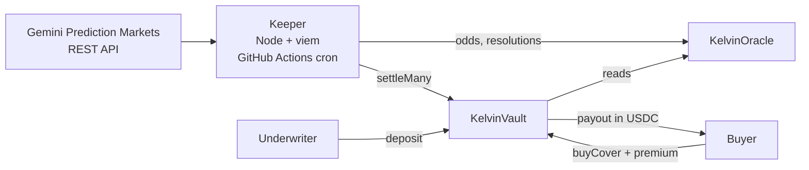

# Kelvin

Weather cover for small businesses. The price comes from Gemini Prediction Markets and the money moves as USDC on Arc.

A patio bar loses a Saturday when it turns cold. A food truck loses a lunch rush when it hits 100. With Kelvin the owner picks the temperature that would hurt tomorrow, pays a few dollars today, and gets paid if it happens. There is no claim to file and no exchange account to open.

Live app: https://calvinman05-oss.github.io/kelvin/ (press Sign in, then Use the demo wallet)

| | |
|---|---|
| Network | Arc Testnet, chain 5042002 |
| KelvinVault | [`0xFF011934e1ADE727cb6271C1BBdCfd668164300b`](https://testnet.arcscan.app/address/0xFF011934e1ADE727cb6271C1BBdCfd668164300b) |
| KelvinOracle | [`0xB31798e27e4E0c9b24B447917bcdAa4DdFFc8044`](https://testnet.arcscan.app/address/0xB31798e27e4E0c9b24B447917bcdAa4DdFFc8044) |

I built this for the University Blockchain Conference Hackathon 2026. It is entered in the DeFi and Onchain Applications track, for Best use of Arc, and for the Gemini Prediction Markets bounty.

## Why I built it

My background is in energy, where everyone hedges the weather. Utilities and trading desks have weather derivatives. Small businesses do not, even though ordinary weather moves US output by up to 3.4% a year, about $485 billion ([NCAR](https://news.ucar.edu/4810/economic-cost-weather-may-total-485-billion-us)). Texas alone has 3.5 million small businesses ([SBA](https://advocacy.sba.gov/wp-content/uploads/2025/06/Texas_2025-State-Profile.pdf)).

The hedges that exist were built for someone else. CME weather futures are monthly degree-day contracts at $20 a degree day, sold through futures brokers ([CME](https://www.cmegroup.com/news/2024/weather-derivatives-grow-as-risks-intensify.html)). Parametric insurance is negotiated deal by deal for large companies. Prediction markets come closest. Gemini has been a CFTC-designated contract market since December 2025 and now lists a market on tomorrow's high temperature for each major US city. But what you get is a trading screen with 2°F buckets and an order book. A bar owner wants to say "pay me if it is under 60" and be done.

Kelvin takes that live price and sells it as a simple policy.

## How it works

1. A keeper reads Gemini's temperature, natural gas and 5-minute Bitcoin markets and posts each contract's best ask to a contract on Arc, as a probability.
2. The buyer picks a threshold, for example "Austin's high is 78°F or hotter." Kelvin adds up the Gemini buckets past that line (78 to 79, 80 to 81, 82 and up) into one trigger. Gemini does not list that strike on its own.
3. The vault quotes a premium: payout times the summed odds plus a spread. The spread starts at 2% and rises as the pool fills.
4. The buyer pays once. USDC is Arc's native asset, so the premium is sent as the transaction's value. There is no token approval and no separate gas token.
5. The full payout is locked in the vault at the moment of sale. An underwriting pool is on the other side.
6. When Gemini resolves the market, the keeper copies the result on-chain and settles the policy. Anyone is allowed to call settle. The payout always goes to the policy holder.

## What is new and what is not

Hedging small-business risk with prediction markets is not my idea. Kalshi promotes it, and a tool called [Blanket](https://fortune.com/2026/08/07/exclusive-kalshi-blanket-small-business-hedge-hypergamblification/) matches a business to Kalshi contracts. Both stop at finding the contract and send you to the exchange. On-chain weather cover is not new either. Arbol and Etherisc have sold it, but they price the weather themselves.

Kelvin sits between the two. The prediction market sets the price and decides the outcome, and a pool on Arc underwrites the policy. That means the buyer can choose a threshold the exchange does not list, does not need an exchange account, and can be a piece of software as easily as a person. A point-of-sale tool could call `buyCover` in one transaction.

## Architecture



| Part | Where | Notes |
|---|---|---|
| Contracts | `contracts/src` | Solidity 0.8.28, Foundry, no external dependencies |
| Tests | `contracts/test/Kelvin.t.sol` | 20 tests, including a fuzz test that the vault can always pay what it owes |
| Keeper | `keeper/keeper.mjs` | Runs on a schedule in `.github/workflows/keeper.yml`, or locally |
| Web app | `web/` | Vite, React and viem. A static build that reads everything from Arc |

`KelvinOracle` stores, for each Gemini contract, its probability in basis points, when that was last updated, its expiry, the time sales close, and its final resolution. Only the keeper can write to it and a resolution cannot be changed. A market id is `keccak256` of the Gemini instrument symbol, for example `GEMI-WXHIGH-AUS-2611210459-78TO79`.

`KelvinVault` has `quote`, `buyCover`, `settle`, `settleMany`, `deposit` and `withdraw`. It also has `withdrawOwed`, which a holder can call if a payout could not be pushed to them.

## How it uses Arc

Everything is in USDC: the premium, the collateral, the payout and the gas. A $5 policy costs well under a dollar plus about a cent of gas, and the buyer never has to hold a second token.

Because USDC is the native asset, `buyCover` and `deposit` are payable functions. The usual approve-then-transfer pair becomes one transaction, and no allowance is left behind.

Native USDC on Arc has 18 decimals and its ERC-20 view has 6. The vault keeps every amount to a whole millionth of a dollar and rounds premiums up, so the two views always agree.

Arc can refuse transfers to blocklisted addresses. If a payout cannot be delivered, the vault records it as owed to that holder and carries on settling everyone else.

Transactions are final in about a second, which is what makes a small payout worth doing. The app shows the time on every transaction.

## How it uses Gemini Prediction Markets

The keeper uses the public REST API at `https://api.gemini.com/v1/prediction-markets`.

| Call | What it is used for |
|---|---|
| `GET /events?status=active&category=Weather` | Daily high-temperature events (`WXHIGH-<CITY>-...`) and each bucket's `prices.bestAsk` |
| `GET /events?status=active&category=Commodities` | Weekly natural gas price ladders (`NGAS...`) |
| `GET /events?status=active&category=Crypto` | 5-minute Bitcoin markets, so a full buy, resolve and settle cycle can be watched in minutes |
| `GET /events/{ticker}` | Each contract's `resolutionSide` after Gemini settles it |

The best ask is what a buyer would pay for Yes on Gemini, so that is the probability Kelvin charges. If a book has only a bid, the keeper prices above it. If there is no quote, the keeper posts nothing and the vault will not sell.

Gemini resolves its temperature markets from the National Weather Service daily climate report. Kelvin does not run a weather oracle of its own. It copies Gemini's result.

Gemini's weather markets are tightly quoted but lightly traded. Austin's daily high showed 8 contracts of volume the day I built this. A product like Kelvin is a source of real hedging demand for those markets, and routing the pool's exposure back to Gemini is the first thing I would build next.

## Economics and risk

The premium is `payout x (sum of leg odds + spread)`, with `spread = 2% + 8% x utilisation`. Each leg has a floor of 1%. If the trigger misses, the pool keeps the premium. If it hits, the pool pays the full amount.

Every payout is locked when the policy is sold, and underwriters can only withdraw what is not locked. Premiums on open policies are kept out of the share price until the policy settles, so nobody can deposit late and collect premium for risk they did not take.

These limits are enforced by the contract:

| Risk | Limit |
|---|---|
| The buyer knows more than the quote | Each market has a sales close time set when it is listed. For temperature it is about 10am Central on the measured day, before the afternoon high. |
| Stale price | No sale on odds more than 15 minutes old |
| Concentration | 30% of the pool on one Gemini event, 80% locked in total |
| Outcomes that are almost certain | No sale above 90% odds |
| Price moves while confirming | `maxPremium` on `buyCover` |
| The oracle never resolves | Seven days after expiry anyone can unwind the policy and the premium is returned |

What I am assuming, and where it could break:

- The keeper is one trusted key. It cannot move funds, but it could post a wrong price or a wrong result. A real version needs quotes signed at the moment of sale, a dispute window, and more than one reporter.
- Gemini's quote is treated as a fair price. These markets are thin, so today it is mostly one market maker's view. That is why exposure per event is capped.
- The pool is not hedged. It carries the weather risk itself.
- Legs in one event are treated as mutually exclusive. That is true for temperature buckets. For the natural gas ladders the app only sells one leg at a time.
- One day's temperature stands in for one day's revenue. That fits a patio or an outdoor event much better than it fits a monthly power bill, which is why I aimed it at the former.
- This is a testnet prototype. Selling weather cover to US businesses would need a licensed insurer or a regulated venue behind it.

## Run it

You need Node 20.19 or later and [Foundry](https://getfoundry.sh).

```bash
# contracts
cd contracts
forge install foundry-rs/forge-std --no-git
forge test

# keeper (needs a funded Arc testnet key that the oracle has allow-listed)
cd ../keeper
npm install
KEEPER_PRIVATE_KEY=0x... \
ORACLE_ADDRESS=0xB31798e27e4E0c9b24B447917bcdAa4DdFFc8044 \
VAULT_ADDRESS=0xFF011934e1ADE727cb6271C1BBdCfd668164300b \
node keeper.mjs --once

# web app
cd ../web
cp .env.example .env
npm install
npm run dev
```

To deploy your own copy, get testnet USDC from https://faucet.circle.com and run:

```bash
forge create src/KelvinOracle.sol:KelvinOracle --rpc-url https://rpc.testnet.arc.io --private-key $PK --broadcast --constructor-args $KEEPER_ADDRESS
forge create src/KelvinVault.sol:KelvinVault --rpc-url https://rpc.testnet.arc.io --private-key $PK --broadcast --constructor-args $ORACLE_ADDRESS
cast send $VAULT_ADDRESS "deposit()" --value 20ether --rpc-url https://rpc.testnet.arc.io --private-key $PK
```

## What I would build next

1. Hedge the pool on Gemini through the trading API, so underwriters earn the spread and do not carry the weather.
2. Quotes signed at the moment of sale and a dispute window on resolutions, so the keeper does not have to be trusted.
3. A "cover tomorrow" button inside point-of-sale and ticketing software, with Circle Wallets for email sign-in.
4. Longer triggers as more markets list: weekends, rainfall, the number of 100 degree days in a month.

## License

MIT
